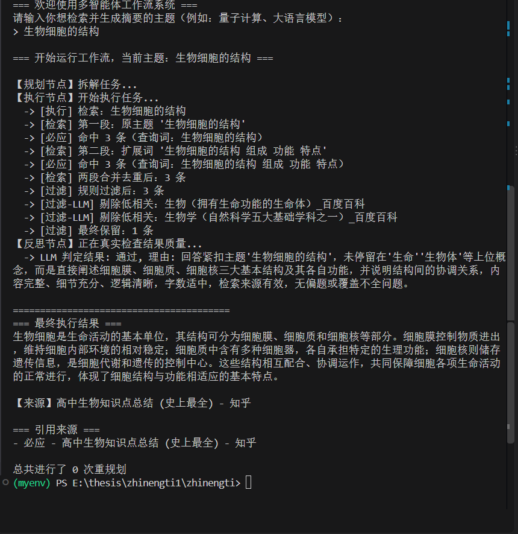
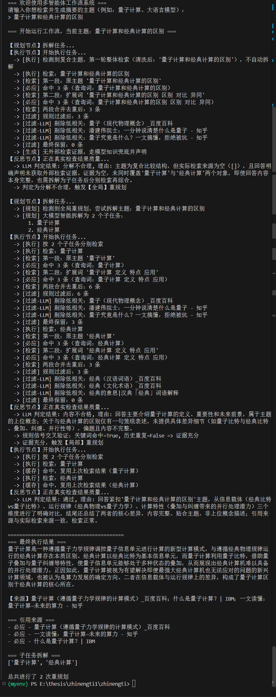
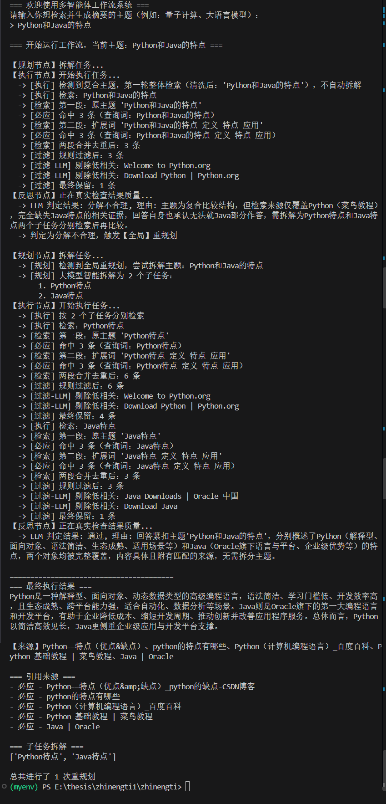

# 基于ReAct循环的多智能体工作流“反思-重规划”策略设计与实现
### ——面向检索摘要任务的证据感知混合反思机制

##  项目简介 (Abstract)

本项目面向大语言模型（LLM）驱动的多智能体工作流，针对现有基于 ReAct 范式的智能体在错误恢复时容易陷入“重复局部错误或全局无效重做”的痛点，设计并实现了一种**证据感知的混合反思重规划策略**。

在 `LangGraph` 状态图框架下，系统构建了“规划—执行—反思—兜底”的四节点工作流。反思节点在输出错误类型的同时，通过“错误信息关键词匹配”与“历史重复错误检测”两个可观测的规则信号交叉判断分类依据是否充分。依据充分时走预设的差异化重规划分支；依据不足或信号冲突时，放弃强制分支，回退到原生自由反思（Free Reflection）进行兜底。系统在保证轻量化、无需模型训练的同时，有效缓解了分类误判带来的负面效应，并具备防幻觉与防死循环的极高工程鲁棒性。

##  核心特性 (Key Features)

1. **双层大模型架构 (Dual-LLM Architecture)**
   - **生成器（Generator）**：采用 DeepSeek-Chat，负责检索增强后的摘要生成与补全。
   - **审查器（Critic）**：采用智谱 GLM-5.3-Flash，作为独立裁判进行语义相关性过滤与质量校验。异构模型交叉验证，彻底消除单一模型的“自我宽容偏差”。
2. **两级条件式重规划 (Conditional Replanning)**
   - **局部重规划**：识别出“偏题/字数少”等明确缺陷时，打回执行节点重新生成。
   - **全局重规划**：针对复合对比类任务，当证据未覆盖双方时，打回规划节点，基于 LLM 智能拆解任务。
3. **证据感知规则信号 (Evidence-Aware Signals)**
   - 不盲目依赖大模型自报的不确定性，而是通过关键词命中和历史重复记录，精准判断是否触发定向重规划。
4. **全链路 Fail-Safe 容错**
   - **防幻觉兜底**：无外部证据时，强制声明基于内部知识。
   - **异常降级**：API 超时/限流时自动重试，解析失败时走规则兜底。
   - **熔断保护**：重规划上限 3 次，彻底杜绝死循环。

##  目录结构 (Directory Structure)

```text
zhinengti/
 ├── main.py                 # 程序入口，组装 LangGraph 状态图
 ├── config.py               # 全局配置及双模型实例化
 ├── agents/                 # 核心智能体节点
 │    ├── __init__.py
 │    └── nodes.py           # Planner, Executor, Reflection
 ├── tools.py                # 检索工具（两段式搜索、双层过滤）
 ├── prompts.py              # 集中管理的提示词
 ├── utils.py                # LLM 调用容错机制与缓存
 ├── requirements.txt        # 依赖项
 └── experiments/            # 实验运行结果截图
```

##  实验运行效果展示

以下为本系统在真实网络环境下，针对不同复杂度任务的核心实验日志截图：

### 实验一：单主题检索与双层过滤验证

> **效果分析**：输入“生物细胞的结构”，系统触发两段式检索。此时必应返回了“生物”、“生物学”等上位泛词条。**LLM 裁判模型成功识别并剔除了这两条噪声数据**，仅保留最精准的知乎文章。高质量的资料输入使得大模型一次性生成了结构完整的摘要，**重规划次数为 0**。这证明了双层过滤机制在抑制概念漂移、提升生成效率方面的关键作用。

### 实验二：极端环境下的双层过滤与局部重规划自救

> **效果分析**：输入“量子计算和经典计算的区别”。在必应引擎极其恶劣的分词缺陷下（将‘经典计算’匹配为‘经典’汉语词语），系统先经历了一次全局拆解。面对子任务依然缺失证据、生成的摘要偏向“量子”概念的困境，裁判模型精准判定“内容不合格且偏题”。系统通过**规则信号交叉验证（关键词命中）**，触发**局部重规划**。最终迫使大模型基于已有证据，重新聚焦于“比特vs量子比特”等核心差异点，成功挽救了输出质量，总计进行了 2 次重规划。

### 实验三：复合任务的智能拆解与全局重规划

> **效果分析**：输入“Python和Java的特点”。第一轮检索由于引擎分词问题，仅覆盖了 Python 一方。反思节点敏锐识别出“证据只覆盖单一对象”，触发**全局重规划**。Planner 利用大模型将任务精准、智能地拆解为 `['Python特点', 'Java特点']`。子任务分别检索后，成功覆盖双方证据，最终生成了准确的对比摘要。这证明了条件式全局重规划的有效性，以及大模型 Planner 的语义拆解能力。


---
*(注：以上截图均截取自真实的本地运行控制台日志。)*

